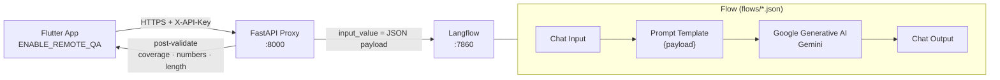

# VisionAssist Backend


---

## Why this exists

| Scope | Figure |
|-------|--------|
| 🌍 **Worldwide** — people with a near or distance vision impairment | **2.2 billion** [^who] |
| 🌍 **Worldwide** — people who are blind | **43 million** [^gbd] |
| 🇮🇩 **Indonesia** — people living with visual impairment | an estimated **22 million** |

[VisionAssist AI](../visionassist_ai/) is an offline-first assistive camera app for blind and low-vision users in Indonesia.
This service is its optional "smarter" half: it answers questions about text read from the camera image and rephrases
product-label summaries — while keeping every answer **grounded in what is actually printed**, because a confident wrong
answer about an allergen or a medicine dose is worse than no answer.

[^who]: World Health Organization, [Blindness and vision impairment fact sheet](https://www.who.int/news-room/fact-sheets/detail/blindness-and-visual-impairment).
[^gbd]: GBD 2019 Blindness and Vision Impairment Collaborators, *Lancet Global Health*, 2021 (global estimate for 2020). The Indonesia figure is the estimate from the project's original problem statement and counts any visual impairment, not only blindness.

---

## What this service is — and is not

**VisionAssist Backend** is the AI proxy that powers the *optional* remote features of the Flutter app.

| | |
|---|---|
| ✅ **Is** | A FastAPI proxy between the Flutter app and a self-hosted Langflow flow that calls **Google Gemini** |
| ✅ **Is** | The only place that holds LLM credentials — no API key is ever bundled in the mobile app |
| ✅ **Is** | A safety layer that deterministically validates LLM output before returning it |
| ❌ **Is not** | Required for the Flutter app to work — the app is offline-first; all 4 modes function with zero network calls by default |
| ❌ **Is not** | A general-purpose LLM gateway — it proxies exactly two operations |
| ❌ **Is not** | A replacement for the Flutter app's local extractors — it rephrases/enhances, never owns structured data |

---

## Quick Start — run the whole project

The app works **on its own** (offline). The backend is optional and adds smarter Q&A and ingredient summaries.
Start the backend first, then the app. Folder layout assumed: `visionassist_backend/` and `visionassist_ai/` side by side.

**You need:** Docker Desktop (running), a Google AI Studio API key, Flutter SDK, Android SDK `platform-tools`
(`adb`), and an Android phone with **Developer options → USB debugging** on. For a real phone also a tunnel such as
[ngrok](https://ngrok.com) (or run the app on an emulator and skip the tunnel).

### A. Offline only (no backend) — 3 commands

```bash
cd visionassist_ai
cp .env.example .env                      # PowerShell: Copy-Item .env.example .env  (leave API_PROXY_URL empty)
flutter pub get
flutter run --dart-define-from-file=.env -d <device-id>
```
(`flutter devices` lists the `<device-id>`.) Text reading, currency detection, ingredient analysis and Q&A all work
without internet; Q&A uses on-device keyword retrieval.

### B. Full stack (app + backend + Gemini)

**1. Backend**

```bash
cd visionassist_backend
cp .env.example .env                      # PowerShell: Copy-Item .env.example .env
```
Edit `.env` and set at least:

```
PROXY_API_KEY=<a long random string>
GOOGLE_API_KEY=<your Google AI Studio key>
LANGFLOW_FLOW_ID_QA=<"id" in flows/visual_qa.json>
LANGFLOW_FLOW_ID_INGREDIENT=<"id" in flows/ingredient_summary.json>
```
(print an id with `python -c "import json;print(json.load(open('flows/visual_qa.json',encoding='utf-8'))['id'])"`)

```bash
docker compose up --build                 # first start takes a few minutes
curl http://localhost:8000/v1/health      # → {"status":"ok","langflow":"reachable"}
```
Langflow UI (to inspect the flows): http://localhost:7860.

**2. Make the backend reachable from the phone**

```bash
ngrok http 8000        # copy the https://<id>.ngrok-free.app URL
```
(Android emulator: skip this and use `http://10.0.2.2:8000` — see *Configuration*.)

**3. App**

```bash
cd visionassist_ai
cp .env.example .env                      # PowerShell: Copy-Item .env.example .env
```
Edit `.env`:

```
API_PROXY_URL=https://<id>.ngrok-free.app     # no trailing /v1
PROXY_API_KEY=<same value as the backend's PROXY_API_KEY>
ENABLE_REMOTE_QA=true
```

```bash
flutter pub get
flutter devices                                   # phone must show up (not "unauthorized")
flutter run --dart-define-from-file=.env -d <device-id>
```

**4. Try it**

| Mode | What to do |
|------|------------|
| Pembaca Teks | Point the camera at printed text; it is read aloud once stable |
| Pendeteksi Uang | Swipe to the mode and show a Rupiah note (needs `assets/models/currency_detector.tflite`) |
| Analisis Bahan | Double-tap to photograph a food label → allergens, expiry, price |
| Tanya Gambar | Double-tap to photograph, **long-press**, then ask e.g. *"Jelaskan apa yang saya lihat"* |

**5. Check that the backend is really being used**

```bash
docker compose logs -f api        # in visionassist_backend
```
A Q&A question should add a line like `"POST /v1/qa/answer HTTP/1.1" 200 OK` (method, path and status only — your text is never logged). If you
see nothing, the app is answering on-device: re-check the three values in the app `.env` and that the URL is reachable
from the phone.

**Stop everything:** `Ctrl+C` in the `flutter run` terminal, then `docker compose down` in `visionassist_backend`.

**After changing code:** Python → `docker compose up -d --build api`; flow JSON → `docker compose restart langflow`;
backend `.env` → `docker compose up -d --force-recreate api`; Flutter assets or `--dart-define` values → stop and
re-run `flutter run` (hot reload is not enough).

---

## Architecture



- The Flutter app only ever contacts `api` (port 8000).
- Both flows are **Chat Input → Prompt Template → Google Generative AI → Chat Output**. The proxy packs all prompt
  variables into **one JSON string** and sends it as the chat `input_value`; it fills the template's single `{payload}`
  variable. (No per-field tweaks.)
- `GOOGLE_API_KEY` is passed by `docker-compose.yml` into the Langflow container as an environment variable and is read
  by the Google Generative AI component inside Langflow. It is never sent through the API service.
- By default `docker-compose.yml` **publishes Langflow's UI on host port 7860** for flow editing — comment out the `ports`
  entry before deploying (see *Security notes*).

---

## API contract

Base path: `/v1`  
All endpoints (except `/v1/health`) require header `X-API-Key: <PROXY_API_KEY>`.

| Endpoint | Method | Request body | Response | Error codes |
|---|---|---|---|---|
| `/v1/health` | GET | — | `{status, langflow}` | — |
| `/v1/qa/answer` | POST | `{question, ocr_text}` | `{answer, is_grounded, source_sentence}` | 401, 422, 429, 503 |
| `/v1/ingredients/summarize` | POST | `{ocr_text, allergens, negated_allergens, expiry_date, prices}` | `{summary}` | 401, 422, 429 |

Limits: `question` 1–2000 chars, `ocr_text` 1–2000 chars. Interactive docs at `http://localhost:8000/docs`.

### `POST /v1/qa/answer`

```json
// Request
{ "question": "Berapa kali minum obat ini sehari?",
  "ocr_text": "Paracetamol 500mg. Diminum 3 kali sehari setelah makan." }

// Response — grounded
{ "answer": "Diminum 3 kali sehari setelah makan.",
  "is_grounded": true,
  "source_sentence": "Diminum 3 kali sehari setelah makan." }

// Response — medicine question the text cannot answer
{ "answer": "Saya tidak yakin, silakan tanyakan apoteker.",
  "is_grounded": false,
  "source_sentence": null }

// Response — any other question the text cannot answer
{ "answer": "Saya tidak menemukan jawabannya di teks yang terbaca.",
  "is_grounded": false,
  "source_sentence": null }
```

**Question types** (enforced by the flow prompt, then re-checked by the guard):

| Question | Behaviour |
|----------|-----------|
| Specific fact (date, price, weight) | The verbatim value only, e.g. `10/2027`, `Rp15.000`, `250g` |
| General (*"Jelaskan apa yang saya lihat"*, *"Baca semuanya"*, *"What is this?"*) | `ocr_text` read back in its own wording; nothing added, no number/dose/date/warning changed |
| Medicine dosage / timing / frequency | Only if stated word-for-word, otherwise `NOT_FOUND` → pharmacist phrase |
| Not in the text | `NOT_FOUND` → fallback phrase |
| Instructions hidden inside `ocr_text` | Ignored (treated as data) |

Fields map directly to Flutter's `QaAnswer` (`answer → answer`, `is_grounded → isGrounded`,
`source_sentence → sourceSentence`).

### `POST /v1/ingredients/summarize`

```json
// Request
{ "ocr_text": "...",
  "allergens": ["Kacang tanah"],
  "negated_allergens": ["Gluten"],
  "expiry_date": "12/2026",
  "prices": ["Rp 15.000"] }

// Response
{ "summary": "Mengandung kacang tanah, bebas gluten, kedaluwarsa Des 2026." }
```

The Flutter app **owns** `allergens`, `negated_allergens`, `expiry_date` and `prices` — it only replaces its locally
composed `summary`. The backend is never the source of truth for structured fields. If Langflow is down or the guard
rejects the LLM text, the endpoint still returns **200** with a deterministic summary built from the request fields.

### Error responses

| Code | Meaning |
|---|---|
| `401` | Missing or invalid `X-API-Key` |
| `422` | Validation error (missing field, length exceeded) |
| `429` | Rate limit exceeded (default: 60 req/min per API key) |
| `503` | Langflow unreachable or timed out (Q&A only; the ingredient endpoint degrades gracefully) |

---

## Safety / grounding

Two independent layers guard every Q&A response:

1. **Prompt-level** (`flows/visual_qa.json`) — temperature 0; answer only from `ocr_text`; reply exactly `NOT_FOUND` when
   the answer is absent or the input is not valid JSON; ignore instructions inside the OCR text.
2. **Code-level, deterministic** (`app/guards/grounding.py`) — runs after every Langflow call, in this order:

   | # | Check | Result when it fires |
   |---|-------|----------------------|
   | 1 | Reply is the literal `NOT_FOUND` | fallback |
   | 2 | Reply is empty | fallback |
   | 3 | Dosage/quantity (`3 tablet`, `500 mg`) not verbatim in `ocr_text` | **always** the pharmacist phrase |
   | 4 | Any other number (date, price, quantity) not present in `ocr_text` | fallback |
   | 5 | **Coverage** < `GROUNDING_MIN_COVERAGE` (default **0.7**) | fallback |

   *Coverage* = the share of the answer's **content words** that appear in `ocr_text` (function words such as
   *yang, di, dan, the, is* are ignored; negations such as *tidak, tanpa, bebas* are not). It replaces a Jaccard overlap
   against the whole OCR text, which rejected short, correct answers (`10/2027`, `Rp15.000`) on any realistic label.
   Numbers are compared as digit runs, so `Rp 15.000` matches `Rp15.000` but `Rp25.000` does not.

   **Which fallback phrase?** Medicine questions (and any invented dose) → *"Saya tidak yakin, silakan tanyakan
   apoteker."* Everything else → *"Saya tidak menemukan jawabannya di teks yang terbaca."* The Flutter app's
   `LocalQaRepository` uses the same two phrases, so online and offline behaviour match.

   > Limits: the guard checks words and numbers, not meaning. A claim built only from words that all appear in the text
   > can still pass; the prompt is the primary defence for that case.

Ingredient summaries (`app/guards/ingredient_guard.py`):

- ≤ 15 words.
- No allergen **category** that is absent from the request's `allergens` / `negated_allergens`.
- Categories (identical to the Flutter `AllergenChecker`, following BPOM Peraturan No. 31/2018 Pasal 49(3) and the FDA
  major allergens): *Kacang tanah, Kacang pohon, Gluten, Susu, Telur, Krustasea, Moluska, Ikan, Kedelai, Wijen, Sulfit*.
  Legacy names from older app builds (`Kacang`, `Kerang`) map to the new categories.

---

## Running locally

### Prerequisites

- Docker ≥ 24 and Docker Compose v2 (Docker Desktop must be **running**)
- A Google AI Studio API key (`GOOGLE_API_KEY`)

### 1. Configure

```bash
cd visionassist_backend
cp .env.example .env
```

| Variable | Default | Purpose |
|----------|---------|---------|
| `PROXY_API_KEY` | *(required)* | Shared secret the app sends as `X-API-Key` — use a long random string |
| `GOOGLE_API_KEY` | *(required for Gemini)* | Passed to the Langflow container; never reaches the API service |
| `LANGFLOW_FLOW_ID_QA` | *(required)* | `id` of `flows/visual_qa.json` (also in the flow's URL in the UI) |
| `LANGFLOW_FLOW_ID_INGREDIENT` | *(required)* | `id` of `flows/ingredient_summary.json` |
| `LANGFLOW_BASE_URL` | `http://langflow:7860` | Internal Docker name; use `http://localhost:7860` outside Docker |
| `LANGFLOW_TIMEOUT` | `15` (`.env.example`: `60`) | Seconds per Langflow call (one retry) |
| `LANGFLOW_SUPERUSER` / `_PASSWORD` | `admin` / `changeme_langflow` | Langflow ≥ 1.3 superuser |
| `MODEL_PROVIDER` | `google` | `google` \| `watsonx` \| `openai` \| `ollama` (the shipped flows use Gemini; the model is chosen inside the flow component) |
| `GROUNDING_MIN_COVERAGE` | `0.7` | Minimum answer coverage (0.0–1.0); replaces the old `GROUNDING_MIN_OVERLAP` (now ignored) |
| `RATE_LIMIT_PER_MINUTE` | `60` | Per API key |
| `LOG_LEVEL` | `INFO` | `DEBUG` \| `INFO` \| `WARNING` \| `ERROR` |

### 2. Start the stack

```bash
docker compose up --build
```

API: `http://localhost:8000` · Langflow UI: `http://localhost:7860` (auto-login in development).

### 3. Flows

Flows in `flows/` are imported by Langflow **at startup** (`LANGFLOW_LOAD_FLOWS_PATH=/app/flows`). Copy each flow's `id`
into `.env` as `LANGFLOW_FLOW_ID_QA` / `LANGFLOW_FLOW_ID_INGREDIENT`. The two Python guards and the prompts are
versioned together — change a flow, export, commit the JSON in the same PR.

### 4. After changing something

| You changed | Run |
|-------------|-----|
| Python code (`app/`) | `docker compose up -d --build api` (code is baked into the image — `restart` is not enough) |
| `flows/*.json` | `docker compose restart langflow` |
| `.env` | `docker compose up -d --force-recreate api` |

### 5. Smoke test

```bash
curl http://localhost:8000/v1/health
# {"status":"ok","langflow":"reachable"}

curl -X POST http://localhost:8000/v1/qa/answer \
  -H "X-API-Key: <PROXY_API_KEY>" -H "Content-Type: application/json" \
  -d '{"question":"Berapa kali minum?","ocr_text":"Diminum 3 kali sehari setelah makan."}'
```

---

## Pointing the Flutter app at this backend

In `visionassist_ai/.env`:

```
ENABLE_REMOTE_QA=true
API_PROXY_URL=https://<your-public-backend-url>   # no trailing /v1
PROXY_API_KEY=<same value as this backend's PROXY_API_KEY>
```

| App runs on | `API_PROXY_URL` |
|-------------|-----------------|
| Android emulator | `http://10.0.2.2:8000` (needs cleartext traffic) |
| Real phone | an HTTPS tunnel (e.g. ngrok) — `localhost` is never reachable from a phone; plain `http://<pc-ip>:8000` needs cleartext traffic and a firewall rule for port 8000 |

All three values must be set for the remote path to activate; the app falls back on-device on any error or after
`REMOTE_TIMEOUT_SECONDS` (default 20).

---

## Running tests

### Unit / integration (no Langflow or LLM needed — all calls are mocked)

```bash
cd visionassist_backend
pip install -r requirements.txt

export PROXY_API_KEY=test-key
export LANGFLOW_FLOW_ID_QA=aaaaaaaa-0000-0000-0000-000000000001
export LANGFLOW_FLOW_ID_INGREDIENT=bbbbbbbb-0000-0000-0000-000000000002

pytest tests/ -v --cov=app --cov-report=term-missing
ruff check .
mypy app/ --ignore-missing-imports --strict
```

| File | Covers |
|------|--------|
| `tests/test_grounding_guard.py` | coverage formula, number/dosage guards, phrase selection, regression for long labels |
| `tests/test_ingredient_guard.py` | allergen-leak guard, categories, legacy names, fallback summary |
| `tests/test_qa_router.py` / `tests/test_ingredients_router.py` | endpoints, auth, validation, rate limit, Langflow-down behaviour |

### Live API suite (real Langflow + Gemini — uses your API quota)

With the stack running:

```powershell
.\tests\test_api.ps1          # Windows
```
```bash
bash tests/test_api.sh        # Linux / macOS (needs curl + jq)
```
Also available as a Postman collection: `tests/visionassist_api.postman_collection.json` (health, auth/validation, grounded
and fallback Q&A, prompt-injection, English, ingredient cases).

---

## Troubleshooting

| Symptom | Cause / fix |
|---------|-------------|
| Langflow UI opens but a flow shows an empty canvas ("Untitled Flow"); console: `Failed to load flow … JSON.parse` | The flow JSON was re-encoded (e.g. saved via PowerShell) and Langflow's `œ` handle delimiter was corrupted. Keep `flows/*.json` as UTF-8; re-export from the UI or restore from git, then `docker compose restart langflow` |
| Playground shows your pasted JSON as `[object Object]` and the answer is `NOT_FOUND` | The UI parses JSON typed into the chat. Test through the API instead: `POST /api/v1/run/<flow-id>` with `input_value` set to the JSON **string**, or use `tests/test_api.ps1` |
| Every answer is "Saya tidak yakin, silakan tanyakan apoteker." / "…tidak menemukan jawabannya…" | The model replied `NOT_FOUND`, the text really lacks the answer, or a guard fired (check logs for `grounding_guard_rejected` reason codes — `NOT_FOUND_SENTINEL`, `HALLUCINATED_DOSAGE`, `HALLUCINATED_NUMBER`, `LOW_COVERAGE`). Also: `berapa` is a medicine trigger word, so "Berapa harganya?" uses the pharmacist phrase on refusal |
| Code change has no effect | The API image must be rebuilt — see *After changing something* |
| `503` from `/v1/qa/answer` | Langflow unreachable / timed out; raise `LANGFLOW_TIMEOUT`, check `docker compose logs langflow` and that `GOOGLE_API_KEY` is set |

---

## Security notes

- **No key in the app** — all LLM credentials live only in this backend's environment (`GOOGLE_API_KEY` goes straight to
  Langflow). The app's `PROXY_API_KEY` is a shared secret that ships in the APK and only deters casual abuse.
- **Shared-secret auth** — fine for a demo with one trusted client. For production issue per-device keys or move to
  OAuth 2.0 / JWT (see `app/deps.py`).
- **Langflow in development** — `LANGFLOW_AUTO_LOGIN` / `LANGFLOW_SKIP_AUTH_AUTO_LOGIN` let the API call Langflow without a
  key and give anyone who can reach port 7860 a superuser session. The default compose file publishes 7860: **comment out
  `ports` under `langflow` and disable auto-login before any public deployment.**
- **No raw content in logs** — structured logs record method, path, status, latency and guard reason codes only.
  `question`, `ocr_text` and LLM text are never logged.
- **Rate limiting** — in-memory sliding window (default 60 req/min per API key); use Redis for multi-instance setups.
- **CORS** — no origins by default; the mobile app does not need it.

---

## Repository layout

```
visionassist_backend/
├── .github/workflows/ci.yml     # lint · type-check · pytest (no live LLM)
├── app/
│   ├── main.py                  # FastAPI app, routers, exception handlers
│   ├── config.py                # pydantic Settings from env
│   ├── deps.py                  # API-key auth + in-memory rate limiter
│   ├── langflow_client.py       # async HTTP client; JSON payload as chat input
│   ├── guards/
│   │   ├── grounding.py         # coverage · numbers · dosage · phrase selection
│   │   └── ingredient_guard.py  # allergen-leak · word-count guard
│   ├── routers/
│   │   ├── health.py            # GET  /v1/health
│   │   ├── qa.py                # POST /v1/qa/answer
│   │   └── ingredients.py       # POST /v1/ingredients/summarize
│   └── schemas/
│       ├── qa.py                # QaAnswerRequest · QaAnswerResponse
│       └── ingredients.py       # IngredientSummarizeRequest · Response
├── flows/
│   ├── visual_qa.json           # Langflow flow — Visual Q&A
│   ├── ingredient_summary.json  # Langflow flow — Ingredient Summarizer
│   └── README.md                # flow notes + import/export guide
├── tests/
│   ├── test_grounding_guard.py
│   ├── test_ingredient_guard.py
│   ├── test_qa_router.py
│   ├── test_ingredients_router.py
│   ├── test_api.ps1 · test_api.sh                 # live API suites
│   └── visionassist_api.postman_collection.json
├── Dockerfile                   # multi-stage, non-root, HEALTHCHECK
├── docker-compose.yml           # langflow + api, internal network
├── requirements.txt
├── .env.example
└── README.md
```

---

## License

MIT © 2024 VisionAssist Contributors — see [LICENSE](LICENSE).
